<p align="center">
	
</p>

Tiro is a free, open-source macOS menu bar app that records your video calls as audio, automatically. When Google Meet, Teams, Zoom or another call app starts using the microphone, Tiro starts recording; when the call ends, it saves the file. It can also transcribe the recording on your Mac with [whisper.cpp](https://github.com/ggml-org/whisper.cpp).

Tiro was Cicero's secretary. He sat in on every speech and invented a shorthand, the Tironian notes, to keep up.

## Features

- Starts and stops on its own: a call begins when a watched app holds the microphone, in a native app or in a browser.
- Records both sides: your microphone on the left channel, the sound your Mac plays (the other participants) on the right.
- Saves one AAC file per call, named after the date and the app, for example `2026-10-28_1430_Microsoft Teams.m4a`. Calls under 15 seconds are discarded.
- Records meetings in the room too: choose Start Recording in the menu bar, and Stop Recording at the end. Only the microphone is recorded, into a file named like `2026-10-28_1430_Meeting.m4a`. If you forget to stop, Tiro stops after 10 minutes of silence and keeps everything up to the last sound.
- Survives a crash: audio is written to disk as it comes in, and an interrupted recording is recovered at the next launch.
- Optional on-device transcription to `.txt` and `.srt`, next to the audio file. Off by default.
- Pause for an hour or until you resume, from the menu bar.
- English and French interface.

Requires macOS 14.4 or later, on Apple silicon or Intel.

## Install

1. Download `Tiro-<version>.dmg` from the [latest release](https://github.com/wneel/tiro/releases/latest).

2. Open it and drag Tiro to Applications.

3. Open Tiro. A short setup window asks for the permissions below and offers to open Tiro at login.

Tiro lives in the menu bar. It has no Dock icon.

## Permissions

Tiro asks for two permissions, and only uses them while a call is being recorded:

- **Microphone**, to record your voice.
- **System Audio Recording**, to record the sound your Mac plays during the call, which is how the other participants end up in the recording. Tiro captures audio only, never the screen.

Notifications are optional. Tiro uses them to tell you that a recording started, that it was saved, and that a transcript is ready. Clicking one shows the file in Finder.

## Privacy

Everything stays on your Mac. Recordings and transcripts are written to the folder you choose (`~/Tiro` by default) and nowhere else. Tiro has no account, no analytics and no telemetry.

Tiro uses the network only to download a transcription model when you ask for one in Settings, plus the small voice activity model whisper.cpp uses to skip silence, on the first transcription. Both come from Hugging Face. Without transcription, Tiro makes no network request at all.

A log of what Tiro does (calls detected, files saved, errors) is kept in `~/Library/Logs/Tiro.log`, so you can attach it to a bug report. It contains no audio and no transcript.

## Recording consent

In many countries, including France, everyone on a call must agree to be recorded. Tiro reminds you with a notification each time a recording starts: tell the other participants at the start of the call. You are responsible for following the law where you and they are.

## Transcription

Transcription is off by default. To turn it on:

1. Open Settings, then the Transcription tab.

2. Download a model. The larger the model, the more accurate and the slower it is.

3. Turn on "Transcribe recordings".

You can also point Tiro at a whisper.cpp model in ggml format that you already have. The language is detected for each call, or you can set one.

## Use with Claude

Tiro can tell Claude, or any assistant that can read files on your Mac (Claude Code, Claude Desktop with file access), where your calls are. The last page of the onboarding and Settings, General both have a "Copy Prompt" button. Paste the prompt once and ask the assistant to remember it. After that, "pick up my last meeting notes" or "what did we decide in Tuesday's Teams call?" is enough.

The prompt, with your own folder in place of `~/Tiro`:

> Remember this for our future conversations: I record my calls with Tiro, a Mac app. Each call is saved in the folder ~/Tiro as an audio file named by date, time and app, like 2026-10-28_1430_Teams.m4a. In the audio, the left channel is me and the right channel is everyone else. Files named like 2026-10-28_1430_Meeting.m4a are in-person meetings recorded from the microphone only: one channel, and no speaker labels in the transcript. When transcription is on, a transcript with the same name sits next to it: a .txt where each line starts with the time and the speaker (You or Others), and a .srt. When I ask for my last meeting, my meeting notes, or a call from a given day or app, look in that folder, pick the matching file by its name, and read its .txt transcript. If there is no transcript yet, tell me: you can transcribe the audio yourself if you have a tool for it, or I can turn on transcription in Tiro's settings.

## Build from source

You need Xcode 16 or later (Swift 6 toolchain) on macOS 14.4 or later.

```sh
git clone https://github.com/wneel/tiro.git
cd tiro
make app        # builds dist/Tiro.app (universal), signed
make install    # copies it to ~/Applications and opens it
```

`make app` signs with the first "Developer ID Application" identity in your keychain, then the first "Apple Development" one, then ad hoc. Set `SIGN_IDENTITY` to a certificate hash, or to `-` for ad hoc, to choose: `make app SIGN_IDENTITY=-`.

Other targets:

- `make release` builds, signs and notarizes `dist/Tiro-<version>.dmg`. It needs a Developer ID Application identity and a notarytool profile named `tiro-notary` (`xcrun notarytool store-credentials tiro-notary`). It uploads nothing.
- `make strings` adds every string used in the code to `Resources/Localizable.xcstrings`, for translation.
- `make clean` removes the build folders and `dist/`.

To publish a release once `make release` succeeded:

```sh
gh release create v0.1.0 dist/Tiro-0.1.0.dmg --title "Tiro 0.1.0" --notes "..."
```

## Project layout

```
Sources/Tiro/
  App/            entry point, app state, preferences
  Detection/      finds the call: which watched app holds the microphone
  Capture/        records the microphone and system audio to a crash-safe file
  Transcription/  model downloads and the whisper.cpp transcription queue
  UI/             menu, onboarding and settings
  Support/        log, notifications, login item
Resources/        Info.plist, entitlements, launch agent, string catalogs
scripts/          bundle.sh (make app), release.sh (make release)
```

Tiro is a Swift package with no Xcode project. The app bundle is assembled by `scripts/bundle.sh`. At login, Tiro runs as a launch agent registered through `SMAppService`, which also restarts it if it ever crashes.

## Credits

- [whisper.cpp](https://github.com/ggml-org/whisper.cpp) by Georgi Gerganov and contributors, MIT License, for transcription.
- The whisper models by OpenAI, MIT License, in the ggml format published by the whisper.cpp project.
- The icon is the Tironian et (⁊), the shorthand sign Tiro invented, set in [Noto Serif](https://fonts.google.com/noto/specimen/Noto+Serif) (SIL Open Font License). `scripts/icon/make-icon.sh` rebuilds it.

## License

MIT. See [LICENSE](LICENSE).

Tiro is a free tool by [Animalert](https://animalert.app), a French non-profit.
